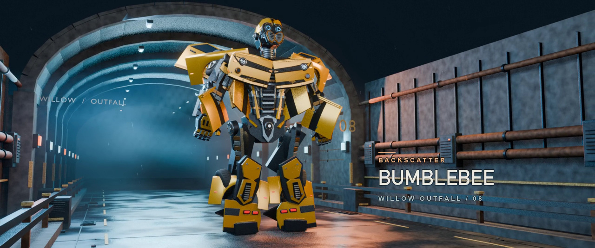

# 大黄蜂·午夜回波 · GPT-6.2 Sol

48 秒三维短片。Camaro 在雨后溢洪道制动并变形，随后切到蓝色环眼特写和双片面罩部署。42 个具名刚体装配贯穿车态、人形和过渡，其中连续变形镜头约 15.9 秒。

[案例页](../../README.md) · [共同任务](../../task/brief.md) · [本地工作区](../../../../docs/本地工作区.md)

## 输入与制作

- 执行模型为 GPT-6.2 Sol，署名由用户确认。执行工具为 Codex，精确模型 ID 未归档。
- 按输入 v1 的 `bumblebee-nov09-signal` 包独立实现，含 2 张 TOMY MPM-3 产品图。该包的 `inputs.json` 文件 SHA-256 为 `bf443a4eaf97c9690e4817338cb50a60c14324f5ddd06a98702cda49a8d9c53c`。本轮另参考 2007 年同期头部宣传照及 Camaro 车型资料。
- 使用 Blender 4.5.4 LTS、EEVEE、Python、NumPy、Pillow 和 FFmpeg。溢洪道、镜头、机械声与音乐按本片设计。
- 内部连接、变形路径与面罩铰接含推断。机械碰撞与原片逐帧对齐尚未验证。

## 交付与验收

| 项目 | 结果 |
|---|---|
| 成片 | `大黄蜂-午夜回波.mp4`，1280 × 536，24 fps，48 秒，H.264 + 48 kHz 双声道 AAC |
| 可编辑工程 | `backscatter.blend` |
| 验收记录 | 完整解码 1152 帧，FFplay 播放至片尾，本次播放记录丢帧 1 帧 |

成片与工程位于本机 `local/cases/bumblebee-2007/models/gpt-6-2-sol/deliveries/`。从仓库根目录运行 `python3 scripts/workspace.py 大黄蜂 --variant gpt-6-2-sol` 可查询路径。重建命令见本地项目目录的 `制作与复现.md`。

剧照为本轮渲染。角色与影视设计权利见 [NOTICE](../../../../NOTICE.md#变形金刚系列)。
