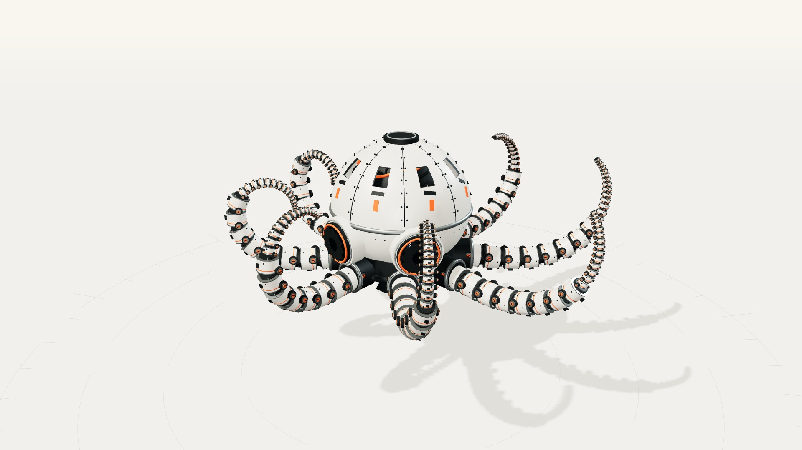

# GPT-6.1 Sol · 机械章鱼 OC-8

暖白影棚、橙色控制台的程序化 3D 机械章鱼。64 秒、11 阶段：喷进、八臂游动、镜组与外壳开合、腕足拆装、推进、姿态调整、双颚、整机拆解与离站。

**仓库文档：** [系列索引](../../../../series/机械复刻系列/README.md) · [快速开始](../../../../docs/快速开始.md)

[](https://topmindspace.github.io/awesome-ai-recreations/cases/oc8/models/gpt-6-1-sol/index.html)

## 在线演示与源码

| 案例 | 在线演示 ↗ | 仓库文件 |
|---|---|---|
| 机械章鱼OC-8 | [互动](https://topmindspace.github.io/awesome-ai-recreations/cases/oc8/models/gpt-6-1-sol/index.html) · [自动巡览](https://topmindspace.github.io/awesome-ai-recreations/cases/oc8/models/gpt-6-1-sol/film.html) | [源码](src) · [规格](spec.md) |

互动页支持拖拽、缩放、部件隔离、爆炸拆解、标注、暂停与进度拖动；空格播放/暂停，左右键按 0.5 秒步进。下载后双击 HTML 可离线运行。

[动作总览](stills/总览-V2-动作完整版接触表.jpg) · [开壳近景](stills/光影-开壳.jpg) · [腕足近景](stills/光影-腕足.jpg) · [原作对照](stills/对照-01.jpg)

## 重建与检查

Node.js 20+。从**本目录**执行：

```bash
npm ci
npx playwright install chromium
node tools/build.mjs all
node tools/check.mjs
node tools/qa.mjs
```

构建更新原发布目录中的两个 HTML。`check` 检查模型与动作约束，`qa` 检查浏览器回放、交互与离线运行。

## 导出视频与截图

视频另需 Python 3.10+、FFmpeg / ffprobe。从本目录执行：

```bash
node tools/video.mjs          # 64 秒 / 1920×1080 / 60 fps，含原创合成音轨
node tools/capture.mjs        # 关键静帧与接触表
node tools/motion-review.mjs  # 连续动作检查表
node tools/compare.mjs        # 原作并排与未配准叠图
```

MP4 输出到 `artifacts/机械章鱼OC-8-GPT-6.1-Sol-动作完整版-64s-1080p60.mp4`；视频和中间文件默认不提交 Git。

## 复刻资料

[可复制任务书](../../task/brief.md) · [规格](spec.md) · [提示词、验证与差距](records/提示词与过程.md) · [验证数据](records/验证结果.json) · [参考来源](../../../../shared/mechanical/deepseek-kit/references/README.md)

从参考重新编写，允许中文化；比例、相机与细节仍有近似。模型展示名按用户指定记录，此前仓库审计接触过其他版本，未作隔离盲测。输入边界见过程记录；原作与第三方许可见 [NOTICE](../../../../NOTICE.md)。
