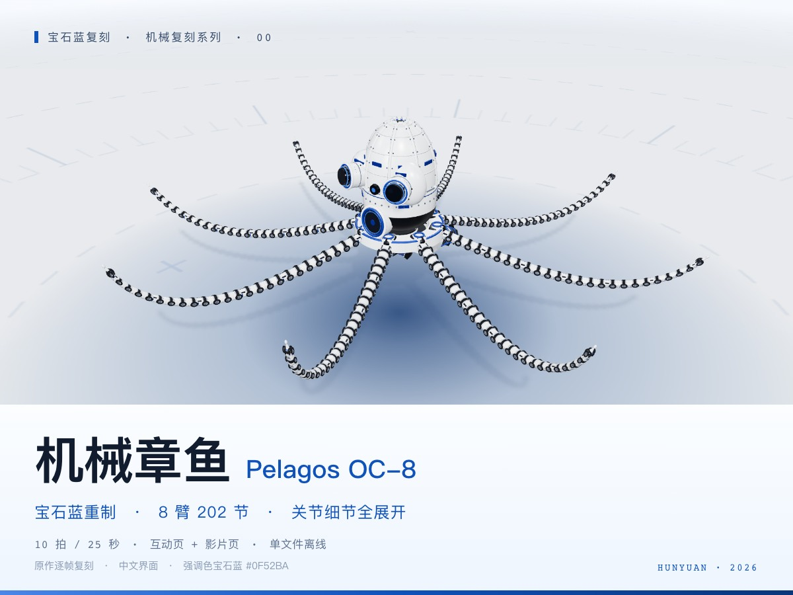

# HY 宝石蓝衍生版 · 机械章鱼 OC-8

基于 DeepSeek 实现改编，保留其 HUD、页面调度与构建链，重写腕足几何并调整配色、近景和拆解表现。独立重写版本见 [HY4 直出版](../hy4-direct/README.md)。

**仓库文档：** [系列索引](../../../../series/机械复刻系列/README.md) · [快速开始](../../../../docs/快速开始.md)

[](https://topmindspace.github.io/awesome-ai-recreations/cases/oc8/models/hy-derived/index.html)

## 在线演示与源码

| 案例 | 在线演示 ↗ | 仓库文件 |
|---|---|---|
| 机械章鱼OC-8 | [互动](https://topmindspace.github.io/awesome-ai-recreations/cases/oc8/models/hy-derived/index.html) · [自动巡览](https://topmindspace.github.io/awesome-ai-recreations/cases/oc8/models/hy-derived/film.html) | [源码](src) · [规格](src/spec.md) |

25 秒自动巡览，下载后双击 HTML 可离线运行。[关节微距](stills/光影-关节微距-无HUD.jpg) · [动作总览](stills/总览-接触表.jpg)

## 重建与检查

需要 Node.js 20+，先按[快速开始](../../../../docs/快速开始.md)安装共享依赖。从**本目录**执行：

```bash
node ../../../../shared/mechanical/hy-derived-kit/build.mjs
node src/shared/check.mjs
node ../../../../shared/mechanical/hy-derived-kit/qa.mjs
```

构建更新本目录两个 HTML。在本目录截取指定时刻：

```bash
node ../../../../shared/mechanical/hy-derived-kit/shot.mjs 00 artifacts/stills --t=0,8,10,20 --mode=film
```

## 复刻资料

[机械章鱼任务书](../../task/brief.md) · [规格与改编项](src/spec.md) · [实现与历史验证](records/实现与验证.md) · [参考来源](references/)

本版作为复用改编案例收录，模型沿用历史 Tencent Hunyuan Hy 署名。来源及许可见 [NOTICE](../../../../NOTICE.md)。
