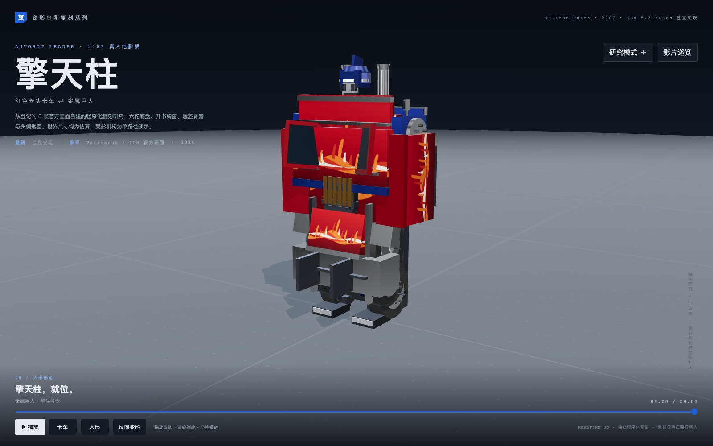

# 擎天柱 · 2007 真人电影版（GLM-5.3-Flash 独立实现）

从登记的 8 帧官方画面自建的程序化复刻研究：72 个活动装配、339 个视觉分件，同一批零件从 Peterbilt 379 长头卡车连续变成人形，支持正反向变形、进度定位、10 步研究索引、拆解重组与影片巡览。世界尺寸均为估算（无标尺），变形机构为单路径演示，与原片仍有明显造型差距（见[实现与验证](records/实现与验证.md)）。



[系列索引](../../../../series/变形金刚系列/README.md) · [可复用协议](../../../../series/变形金刚系列/docs/工作流协议.md) · [2007 任务书](../../task/brief.md) · [仓库快速开始](../../../../docs/快速开始.md)

## 打开与重建

离线打开 [index.html](index.html)（互动）或 [film.html](film.html)（50 秒影片巡览）；Three.js 已内联，无需联网。互动页支持：播放/拖时间线、卡车/人形切换、反向变形、机位预设、灰模、零件分色、关节轴、拆分查看、10 步研究索引与点击拾取装配。

从仓库根目录（Node 22+）重建与验证：

```bash
npm ci --prefix "cases/optimus-prime-2007/models/glm-5-3-flash"
node "cases/optimus-prime-2007/models/glm-5-3-flash/tools/build.mjs"     # 生成 index.html / film.html
node "cases/optimus-prime-2007/models/glm-5-3-flash/tools/check.mjs"     # 数学/结构断言
node "cases/optimus-prime-2007/models/glm-5-3-flash/tools/qa.mjs"        # 浏览器 QA（需 Playwright Chromium）
node "cases/optimus-prime-2007/models/glm-5-3-flash/tools/stills.mjs"    # 静帧与接触表
```

依赖锁定 Three.js 0.186.1 / esbuild 0.28.1 / Playwright 1.58.2（与仓库 GLM kit 同版本，`tools/deps.mjs` 优先本目录、缺失时回退 kit）。首次浏览器 QA 需 `npx --prefix <本目录> playwright install chromium`；macOS 用完整 Chromium + Metal，其他系统用 SwiftShader 参数。

## 署名与边界

- 执行环境为 ZCode 会话，运行模型 **GLM-5.3-Flash**（会话未暴露可独立核验的精确快照 ID），未另行调用其他模型 API。模型署名按实际执行环境记录。
- 目标 `fidelity`，实现 `independent`：几何/机构/材质/摄影从 [references/sources.json](references/sources.json) 的 8 帧（Paramount 官方频道 ×6、ILM 官方制作画面 ×2，哈希已登记）自建，未读取既有案例源码与规格；构建管线（deps 回退 / esbuild 内联 / 断言+QA 模式）复用仓库 C-01 方法工具，属方法复用。
- [测量与机构规格](spec.md)（含两端身份映射与变形相位表） · [生产契约](production.json) · [装配目录](records/assembly-catalog.json) · [实现与验证](records/实现与验证.md)（差异表与证据等级）

## 已知限制

无干净三视图，全部世界尺寸 guess；完整连续变形片段未逐帧观看；无碰撞检测；背视图证据不足（背包 inferred+designed）；手/足细节 designed 简化；火焰拉花为程序化风格化绘制；未渲染编码 MP4（网页巡览为交付影片形态，无音轨）。不含拖车/武器/战斗。

## 来源与许可

角色与参考画面归 Paramount / DreamWorks / Hasbro / ILM，非官方本地研究；原始媒体仅本地保留（local-only），不随仓库分发。新增代码依仓库 MIT；Three.js 运行库许可见 [THIRD_PARTY_NOTICES](../../../../THIRD_PARTY_NOTICES.md)。
