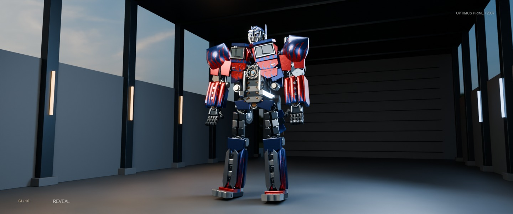

# 擎天柱 · 2007 真人电影版重构



以 2007 真人电影和 ILM 制作画面为参考的程序化三维研究：172 个活动装配、2200 个视觉分件，支持同一模型连续变形、局部组合展开、节点检查和拆解重组，并输出同源 Cycles 影片。模型名称 GPT-6.1 Sol 由用户提供，会话未暴露可独立核验的精确模型 ID。目标 fidelity，实现 derived；沿用 C-01 构建/导出方法，模型与摄影重写。隐藏机构和部分动作属于推演，仍有电影造型差距。

[可复用协议与脚手架](../../../../series/变形金刚系列/docs/工作流协议.md) · [系列方案](../../../../series/变形金刚系列/docs/方案与工作流.md) · [电影任务书](../../task/brief.md)

## 体验与下载

- [在线互动](https://topmindspace.github.io/awesome-ai-recreations/cases/optimus-prime-2007/models/gpt-6-1-sol/index.html) · [离线HTML](index.html)：人形/车辆、完整时间线、胸甲/肩甲/前臂/腿甲/背甲展开、分层拆解与重组、关节轴、灰模、系统分色、装配节点选择。
- [50秒实时巡览](https://topmindspace.github.io/awesome-ai-recreations/cases/optimus-prime-2007/models/gpt-6-1-sol/film.html) · [离线影片页](film.html)：同一模型、10组镜头和完整能力展示。网页用实时PBR/环境反射/阴影/景深/辉光/后处理。
- Cycles电影剪辑：本地 `artifacts/擎天柱-2007-电影版-Cycles.mp4`，28秒/24fps/1920×804。它是同源模型的真实逐帧路径追踪，剪辑按50秒巡览选段和重定时；不是网页录屏或生成视频。

[实际成片分镜](stills/成片分镜.jpg) · [实际验证与未完成项](records/实现与验证.md)

HTML已内联Three.js与HDRI，浏览器可直接离线打开。角落按钮打开“装配研究”；点击实体或树状列表选择装配。静态螺栓/细槽等小件按材质合批，活动甲片、指节与机构节点仍独立。装配数、视觉分件数、渲染Mesh数分别计量，不能把螺栓数当作真实自由度。

## 重建与验证

从仓库根目录运行，Node 22+：

```bash
npm ci --prefix "cases/optimus-prime-2007/models/gpt-6-1-sol"
node "cases/optimus-prime-2007/models/gpt-6-1-sol/node_modules/playwright/cli.js" install chromium
node "cases/optimus-prime-2007/models/gpt-6-1-sol/tools/build.mjs"
node "cases/optimus-prime-2007/models/gpt-6-1-sol/tools/check.mjs"
node "cases/optimus-prime-2007/models/gpt-6-1-sol/tools/qa.mjs"
```

依赖锁定 Three.js 0.186.1、esbuild 0.28.1、Playwright 1.58.2；构建入口优先本目录依赖，若已有仓库GLM kit同版本依赖可回退使用。没有读取旧机械案例源码。本案例读取了旧C-01方法工具，故如实标 derived。

浏览器检查需 Playwright Chromium。macOS使用完整Chromium/Metal；其他系统提供对应平台参数。媒体工具还需 Python 3、NumPy、Pillow、FFmpeg/ffprobe；Python版本依赖见 `requirements.txt`。本轮已取得Blender 4.5.4 LTS便携版，仅在被忽略的local目录；也可将 `OPTIMUS_BLENDER_BIN` 指向自己安装的Blender。

```bash
node "cases/optimus-prime-2007/models/gpt-6-1-sol/tools/export.mjs"
node "cases/optimus-prime-2007/models/gpt-6-1-sol/tools/composition-check.mjs"
node "cases/optimus-prime-2007/models/gpt-6-1-sol/tools/render.mjs"
python3 "cases/optimus-prime-2007/models/gpt-6-1-sol/tools/video-check.py"
node "cases/optimus-prime-2007/models/gpt-6-1-sol/tools/playback-check.mjs"
```

构建/导出/渲染共享资产互斥锁，正式任务期间禁止改写生产输入；正常结束自动释放。异常中断保留锁时先核对记录PID已结束，再处理 `artifacts/asset.lock`。GLB按SHA归档到ignored `artifacts/exports`，避免重导出覆盖唯一旧资产。

导出 GLB 与每帧镜头到 `artifacts/`，再由Blender物理渲染、生成原创声音、FFmpeg封装。保存的blend是50秒母版场景；28秒剪辑由 `tools/edit.py` 映射源时间，不改变角色拓扑。已渲染帧会复用；**修改模型、镜头或材质后须先另存旧帧并重新导出，不能复用过期帧**。仅重做封装用 `node tools/render.mjs --encode-only`（进入本案例目录后执行）。

## 输入、规格与证据

- [官方原始素材与动作观察](references/来源与动作观察.md)、[文件来源/哈希](references/sources.json)
- [原帧测量与差异合同](records/参考测量与差异合同.md)
- [装配与动作规格](spec.md)、[可查询装配清单](records/assembly-catalog.json)、[双端/中段逐装配去向](records/零件去向.md)
- [实现、验证与已知差距](records/实现与验证.md)、[电影与网页功能配乐演示工作流](视频工作流.md)
- [HDRI来源与CC0许可](assets/SOURCES.md)

## 主要边界

原始电影经过剪辑和遮挡，没有取得干净完整的静止三视图或ILM模型。所有世界尺寸与隐藏连接为guess，暂不声明精确机械碰撞/承重/运动学还原。展开、检查核心、工具部署、爆炸拆解与重组含展示设计，不能冒称所选原片已经证实这些能力。能量刃是发光投影，未部署时关闭光与透明度；车身/骨架不以消失或换模型完成变形。

模型与相机可严格回到同一时间点；实时后处理存在小量边缘像素差异，未达整页逐像素相同。Cycles电影与网页使用同源模型/姿态，光照、色彩管理和离线后处理有差异。高分件数、路径追踪或自动测试通过都不等于已经达成电影原作还原度。

## 来源与许可

原始影片及角色权利归 Paramount / DreamWorks / Hasbro 等权利人，ILM制作资料归相应权利人；不随新增代码的MIT许可转移。原片下载仅本地研究；公开精选产品研究板见[参考说明](../../../../series/变形金刚系列/references/README.md)。Three.js MIT完整许可内嵌页面并见仓库第三方声明。环境HDRI为Poly Haven的CC0素材；其余材质纹理与原版影片声音由代码生成；新增功能演示配乐见[视频工作流](视频工作流.md)，没有影视对白/配乐采样或来源不明的三维模型。


## 发布范围

[系列发布说明](../../../../series/变形金刚系列/docs/发布说明.md) · [角色素材与结构库](../../../../series/变形金刚系列/research/characters/README.md) · [正式渲染影片Release](https://github.com/topmindspace/awesome-ai-recreations/releases/tag/transformers-study-v0.1.0)

原视频、大图、依赖、便携工具、GLB/Blend、日志和逐帧缓存保留 local/artifacts。公开目录展示成品、规格与复用方法；新复刻前按 references 来源清单取材。
