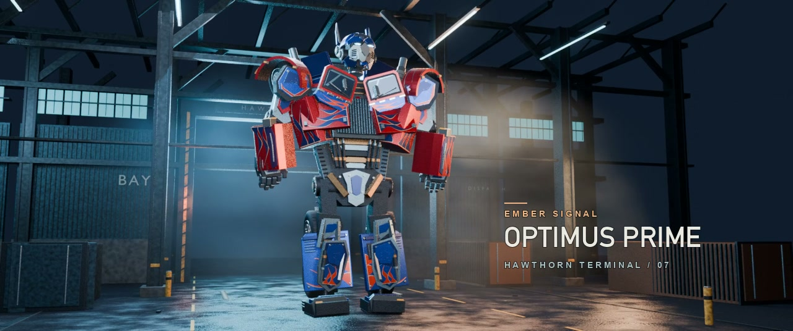

# 擎天柱·余烬信号 · GPT-6.2 Sol

48 秒三维短片。长头卡车驶入夜间货运站，前桥、后轮和胸窗依次转换到人形姿态。车辆、人形与过渡共用 49 个具名刚体装配，可在 Blender 时间轴上查看零件运动。

[案例页](../../README.md) · [共同任务](../../task/brief.md) · [本地工作区](../../../../docs/本地工作区.md)

## 输入与制作

- 执行模型为 GPT-6.2 Sol，署名由用户确认。执行工具为 Codex，精确模型 ID 未归档。
- 按输入 v2 的 `optimus-nov09` 包独立实现，含 8 张 Paramount 或 ILM 参考帧。该包的 `inputs.json` 文件 SHA-256 为 `910220a8d98dfd7c149bab29ae896ef8c21ceea20a803a095626925deeb90c67`。
- 沿用仓库的通用 Blender 工具，使用 Blender 4.5.4 LTS、EEVEE、Python、NumPy、Pillow 和 FFmpeg。货运站、镜头、机械声与音乐按本片设计。
- 内部连接、轴位与尺寸比例含推断。机械碰撞与原片逐帧对齐尚未验证。

## 交付与验收

| 项目 | 结果 |
|---|---|
| 成片 | `擎天柱-余烬信号.mp4`，1280 × 536，24 fps，48 秒，H.264 + 48 kHz 双声道 AAC |
| 可编辑工程 | `ember-signal.blend` |
| 验收记录 | 完整解码 1152 帧，FFplay 播放至片尾，本次播放记录丢帧 0 帧 |

成片与工程位于本机 `local/cases/optimus-prime-2007/models/gpt-6-2-sol/deliveries/`。从仓库根目录运行 `python3 scripts/workspace.py 擎天柱 --variant gpt-6-2-sol` 可查询路径。重建命令见本地项目目录的 `制作与复现.md`。

剧照取自本轮成片。角色与影视设计权利见 [NOTICE](../../../../NOTICE.md#变形金刚系列)。
