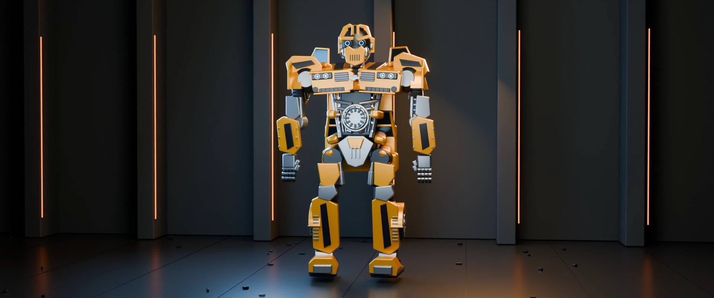

# GPT-6.1 Sol · 大黄蜂 2007 电影版外观研究



GPT-6.1 Sol 在 Codex 中基于两张 TOMY 官方 MPM-3 原图独立建立程序化模型，共 43 个装配、612 个视觉分件。模型署名由用户确认，精确模型 ID 未知。实现来源为 `independent`，视觉目标为 `fidelity`。

车壳曲率、Camaro 轮廓、头雕和背部收纳均有简化，内部连接和变形轨迹属于推演。细节见[规格](spec.md)和[验证记录](records/实现与验证.md)。

[Sol 作品索引](../README.md) · [系列首页](../../../README.md) · [角色研究档案](../../../research/characters/bumblebee-2007/README.md)

## 演示与本地成片

GitHub Pages 提供[在线互动](https://topmindspace.github.io/awesome-ai-recreations/series/变形金刚系列/models/gpt-6.1-sol/bumblebee-2007/index.html)和[在线巡览](https://topmindspace.github.io/awesome-ai-recreations/series/变形金刚系列/models/gpt-6.1-sol/bumblebee-2007/film.html)。下载仓库后，可在浏览器打开同目录的 `index.html` 和 `film.html`。

- 互动页支持车辆／人形切换、时间轴、灰模、分层展开和手动视角。
- 巡览页与 Blender 影片使用同一模型和时间函数，采用实时光照。
- 本地 Cycles 短片输出为 `artifacts/大黄蜂-2007-电影短片.mp4`，规格为 22 秒、24 fps、1920×804、H.264/AAC，配有原创音乐与机械声。
- 可编辑场景为 `artifacts/bumblebee.blend`，包含 528 帧动作和相机关键帧。同源模型导出到 `artifacts/bumblebee.glb`。

[实际成片解码分镜](stills/contact.jpg) · [媒体与播放验证摘要](records/验证摘要.json)

## 重建

需要 Blender 4.5、Node 22+、Python 3（NumPy / Pillow）、FFmpeg 和 ffprobe。将 `blender` 加入 PATH，或将环境变量 `BUMBLEBEE_BLENDER_BIN` 指向 Blender 可执行文件。浏览器验收使用锁定版本的 Playwright Chromium。

```bash
# 从仓库根目录进入案例目录
cd "series/变形金刚系列/models/gpt-6.1-sol/bumblebee-2007"
npm ci
npx playwright install chromium
python3 -m pip install -r requirements.txt
python3 tools/run.py check
python3 tools/run.py build
python3 tools/run.py preflight
node tools/qa.mjs
python3 tools/run.py render
python3 tools/movie.py encode
python3 tools/movie.py check
node tools/qa.mjs --movie
python3 tools/test_movie.py
```

正式设置默认为 1920 像素宽、12 samples。修改场景或设置后会建立新的缓存指纹；编码器拒绝旧指纹、缺帧、不完整 PNG、错误尺寸及目录越界。渲染中不要修改 `src/scene.py`。音轨 `original-score.wav`、`mechanical-effects.wav` 与 `mix.wav` 可单独调整。

原始参考不随 Git 分发。新复刻先用仓库任务导出器获取 `tasks/bumblebee-2007/input.json` 对应的共同输入，并按官方 URL 获取缺失原图；不把本案例源码当作独立复刻输入。

## 来源与权利

[共同任务](../../../../../tasks/bumblebee-2007/brief.md) · [来源与摘要](references/sources.json) · [实际输入与工具](records/provenance.json) · [系列方法](../../../docs/工作流协议.md)。未读取其他角色的几何实现源码，未使用第三方成品模型。Blender 便携程序属于工具复用，不属于几何资产。

角色、名称、电影与产品摄影权利仍归 Hasbro / TOMY / Paramount 等相应权利人。新增代码依仓库 MIT，不能据此再授权角色。环境几何、材质和声音由本版程序生成；没有采样原片声音。Three.js MIT 随离线 HTML 保留，完整许可见本案例 `THIRD_PARTY_LICENSES.txt`；依赖工具遵循各自许可。来源图和影片保留 local / artifacts，不自动提交或发布。
