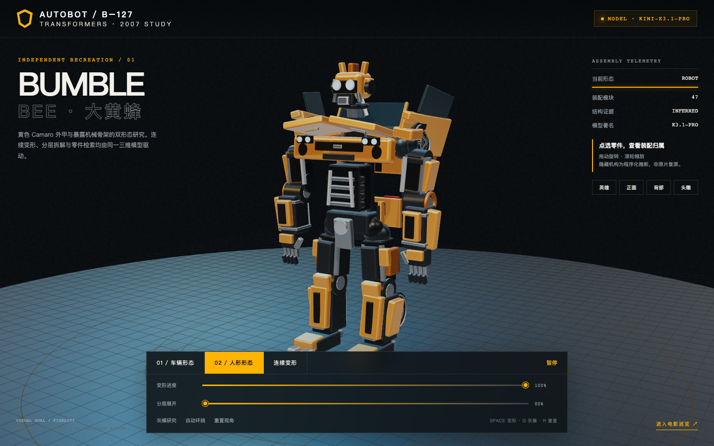

# 大黄蜂 · 2007 真人电影版｜Kimi-K3.1-Pro

基于两张 TOMY MPM-3 官方产品原图独立编写的程序化双形态研究。47 个装配模块共享车辆与人形端点，支持连续变形、分层展开、灰模、零件点选与 20 秒同源巡览。



[系列索引](../../README.md) · [模型索引](../README.md) · [规格与还原合同](spec.md) · [实现与验证](records/实现与验证.md)

## 直接打开

| 交付 | 文件 |
|---|---|
| 离线互动页 | [index.html](index.html) |
| 20 秒电影巡览页 | [film.html](film.html) |
| 有声 MP4（本地生成，不入 Git） | `artifacts/大黄蜂-2007-Kimi-K3.1-Pro.mp4` |
| 车辆 / 中段 / 展开静帧 | [assets/](assets/) |

HTML 已内联 Three.js 和全部界面代码，无需服务器或网络。互动页拖动旋转、滚轮缩放；空格切换变形，G 切换灰模，R 重置视角。巡览页空格播放/暂停，也可拖动时间轴。

## 重建

环境：Node 22+、Python 3、FFmpeg/ffprobe；浏览器验收和视频渲染需要 Playwright Chromium。

```bash
cd "series/变形金刚系列/models/kimi-k3.1-pro/bumblebee-2007"
npm ci
npx playwright install chromium
npm run build
npm run check
node tools/export-contract.mjs
python3 ../../../../../scripts/check_transformer_contract.py production.json --require-ready
npm run capture
npm run video
```

`build` 生成两个自包含 HTML；`capture` 实际打开离线页面，在 `artifacts/qa/` 保存六张截图及报告；精选静帧放在 `assets/`；`video` 以 24fps 渲染 480 帧，生成 48kHz 双声道原创音轨并编码 MP4。所有视频与音轨留 `artifacts/`。

## 本次输入

- 任务：`tasks/bumblebee-2007/input.json`，input version 1。
- 冻结输入包：`local/input-packs/bumblebee-kimi-k3.1-pro/`。
- `inputs.json` SHA-256：`bf443a4eaf97c9690e4817338cb50a60c14324f5ddd06a98702cda49a8d9c53c`。
- 两张参考均为 1460×1000，逐图 URL、哈希与权利边界见 [references/sources.json](references/sources.json)。
- 未追加电影原帧、外部模型、贴图、音乐或其他复刻成品；未改变共同任务要求。

## 实现与限制

- **模型**：Kimi-K3.1-Pro。**执行工具**：WorkBuddy。**目标/来源**：fidelity / independent。
- Three.js 0.180.0 + esbuild 0.25.10 + Playwright 1.55.1；精确版本由锁文件固定。
- 274 个视觉网格归入 47 个稳定模块；数量不代表还原度。
- 车辆→人形是单路径、分相位的确定性插值；隐藏机构、尺寸、声音与镜头为推断或展示设计。
- 没有电影原片逐帧对照、真实碰撞求解、GLB/Blend 导出或 Blender Cycles 渲染。车辆曲面、头雕与手指仍是明显程序化近似。

## 来源与许可

新增代码与文档依仓库 MIT；Three.js 等依赖保留各自许可。角色、电影设计与产品摄影权利归 TOMY / Hasbro / Paramount 等相应权利人。原始产品图只保留在本地输入包，不随本案例公开再分发。音轨由 `tools/sound.py` 原创合成，不含电影或音乐采样。
