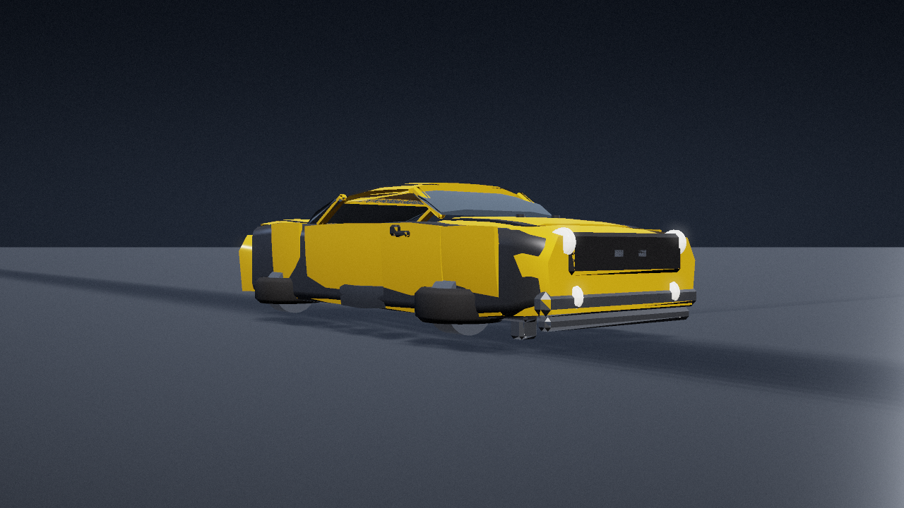

# 大黄蜂 · 2007 真人电影版 · Minimax-M3.1-Flash 独立复刻

按[变形金刚制作协议](../../../docs/工作流协议.md)对 2007 真人电影版大黄蜂做的**独立程序化复刻**：
同一套模型数据同时驱动研究网页、GLB 导出和离线短片，车辆态与人形态由一条确定性时间线连接。

- **执行模型**：Minimax-M3.1-Flash（本仓库案例目录 `models/minimax-m3.1-flash/`）
- **视觉目标**：fidelity　**实现来源**：independent（只看任务书允许的两张 TOMY MPM-3 官方图）
- **精度模型 ID**：会话未暴露可独立核验的精确模型 ID，按系列惯例记为模型名。



## 交付内容

| 交付物 | 位置 | 说明 |
|---|---|---|
| 研究台网页 | `index.html` | 离线可开（three.js 已内联）。时间轴、影片机位、灰模、系统分色、拆解、装配拾取 |
| 巡览影片页 | `film.html` | 同一模型的 20 秒镜头巡览 |
| 程序化模型 | `src/` | 69 装配 / 113 视觉分件 / 51 几何体 / 约 5400 三角形 |
| 同源 GLB | `artifacts/exports/bumblebee-2007.glb` | 含 `vehicle` 与 `robot` 两个场景 |
| 离线短片 | `artifacts/大黄蜂-2007-复刻短片.mp4` | 1280×720 / 24 fps / 20 s / H.264 + AAC，**保留在本地不发布** |
| 原创音轨 | `artifacts/film.wav` | 48 kHz 立体声，全部由 `tools/sound.py` 程序合成，无采样 |
| 装配目录 | `records/assembly-catalog.json` | 装配树、零件唯一归属、时间窗 |
| 零件去向 | `records/零件去向.md` | 车辆态 → 人形态逐装配追踪与证据等级 |
| 规格 | `spec.md` | 尺寸、材质、时间线、相机，逐项标注来源类型 |
| 实现与验证 | `records/实现与验证.md` | 实际跑了什么、验证到什么、差在哪 |

## 复现

需要 Node 22+、Python 3（NumPy、Pillow）、FFmpeg/ffprobe。依赖锁定 Three.js 0.186.1、esbuild 0.28.1。

```bash
cd "series/变形金刚系列/models/minimax-m3.1-flash/bumblebee-2007"

npm ci

# 网页
node tools/build.mjs          # → index.html / film.html
node tools/check.mjs          # 结构检查（装配、位姿、剪辑、契约）
node tools/catalog.mjs        # → records/assembly-catalog.json

# 影片
node tools/export.mjs         # → artifacts/scene/（几何 + 480 帧）+ GLB
python3 tools/sound.py        # → artifacts/film.wav
python3 tools/render/render_film.py --scene artifacts/scene \
    --out-dir artifacts/frames --out-mp4 "artifacts/大黄蜂-2007-复刻短片.mp4" \
    --workers 8 --ss 2 --grain 0.012
python3 tools/video-check.py "artifacts/大黄蜂-2007-复刻短片.mp4" --expect-frames 480
```

仓库自带的契约检查：

```bash
python3 "scripts/check_transformer_contract.py" \
  "series/变形金刚系列/models/minimax-m3.1-flash/bumblebee-2007/production.json" --require-ready
```

## 输入与实现

任务使用 [大黄蜂共同输入](../../../../../tasks/bumblebee-2007/brief.md) v1 的两张 MPM-3 图。原执行工具为 MCode，完整包摘要及人工介入未归档；逐图摘要见 [来源清单](references/sources.json)。

影片使用**软件光栅化器**（`tools/render/`，NumPy + Pillow + FFmpeg）
逐帧渲染同源几何：1280×720 超采样两遍，GGX 高光、半球环境光、解析式地面、
接触阴影、阈值辉光、ACES 色调映射、暗角与确定性颗粒。网页 QA 改用会话内置浏览器完成。

三端同源：`src/model.mjs` 生成几何与端点位姿，`src/rig.mjs` 是纯函数 `stateAt(t)`，
网页、GLB、离线渲染读的是同一份数据，镜头表也只有一份 `src/shots.mjs`。

## 主要边界

- **没有电影原帧**。允许参考只有两张授权产品图，因此真实变形时序、机构连接、镜头构图
  一律未核对；隐藏机构（驾驶舱内头盔、门内前臂、发动机舱机构）标为 inferred，
  展开/拆解等展示动作标为 designed。
- **世界尺寸没有标尺**，全部按 1970 Camaro 公开比例估算（`guess`）。
- **未做碰撞、承重与运动学验证**，不宣称无穿模；中段是带弧线偏置的插值，不是机构解算。
- 翼板是整块车门板，比例偏大；足部是压扁的轮胎，形态简化；躯干相对腿偏厚重。
- 分件数与三角形数只是记账，不代表还原度。
- 自动检查只证明数据完整与文件可解码，**不代替人工试听与审片**。

## 来源与许可

角色与影片权利归 Paramount / DreamWorks / Hasbro 等权利人；TOMY 产品图仅本地研究使用，
未取得再分发许可，不随本仓库发布。程序化模型、材质与音轨由本案例代码生成；
Three.js 为 MIT。原始参考图集中在仓库根的 `local/references/versions/transformers/minimax-m3.1-flash/bumblebee-2007/`。
