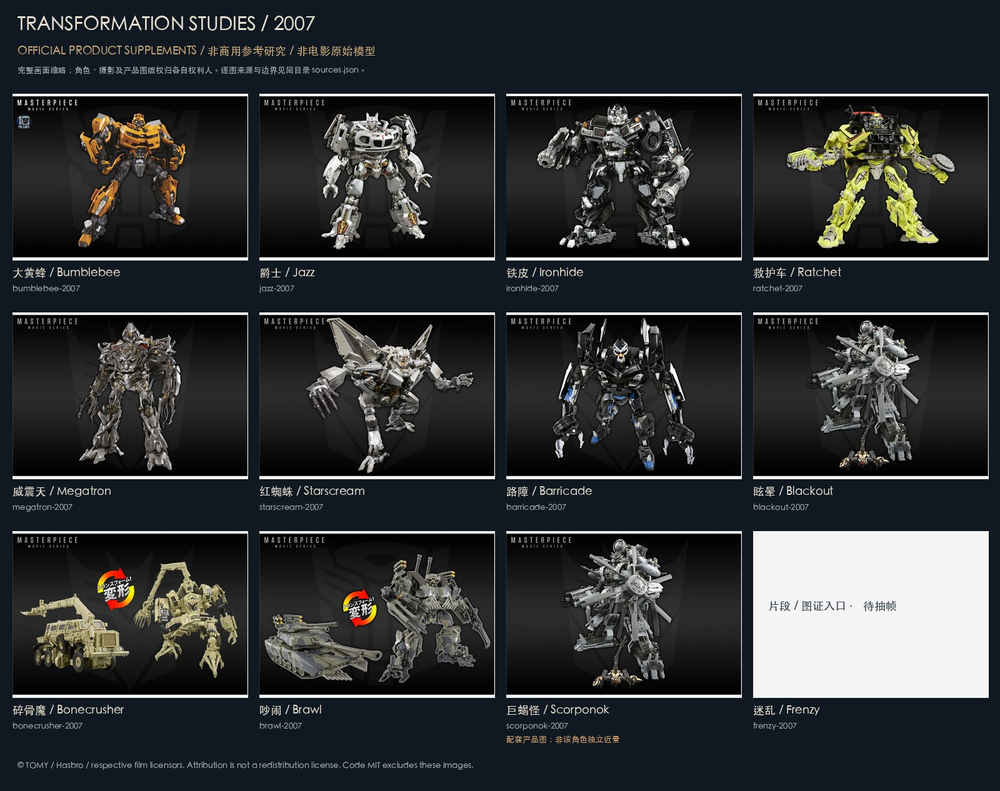

# 角色参考研究板

七张研究板按电影/产品档案年份组织，帮助选择下一角色、观察外观和进入对应资料。它们覆盖 62 个有官方产品样例的档案，每档精选一张完整画面；其余 5 个只列匹配片段/图证入口，标为待抽帧。全部 67 个角色的细粒度拆分候选、版本限制与完整来源在[角色库](../research/characters/README.md)。

| 年份 | 研究板 |
|---|---|
| 2007 | [查看](boards/2007.jpg) |
| 2009 | [查看](boards/2009.jpg) |
| 2011 | [查看](boards/2011.jpg) |
| 2014 | [查看](boards/2014.jpg) |
| 2017 | [查看](boards/2017.jpg) |
| 2018 | [查看](boards/2018.jpg) |
| 2023 | [查看](boards/2023.jpg) |



## 来源与用途

所有图片均来自 TOMY 官方 Transformers 产品页面，保留完整画面和原有标识，只做缩小、拼板及标签。逐图 URL、源页面、角色档案、原始摘要和权利人见 [sources.json](sources.json)；发布板摘要见[素材清单](../publication.json)。

**非官方、非商用参考研究。** 产品图片、摄影和角色/影视设计版权归 TOMY / Hasbro 及各相应权利人，不属于本仓库 MIT 授权。署名和非商用目的不代表已取得再分发许可，也不提供商用资产授权；权利人可通过[仓库 Issue](https://github.com/topmindspace/awesome-ai-recreations/issues)联系移除。原始高分辨率下载、影片及 PDF 不在 Git 分发。

官方产品图只补充外观，不证明电影内部机构。巨蝎怪、激光鸟、转轮、小诸葛的样例可能是配套主体整图，板上已单独标记；不得视作该角色独立近景。大力神卡片为合体成员样例，不是合体全貌；铁渣/嚎叫的 2017 是产品线归档年份，不证明该年影片出场。板上也已单独标记。年份/版本边界以各档案为准。

## 获取精细参考并开始制作

```bash
python3 "series/变形金刚系列/tools/characters.py" show 大黄蜂
python3 "series/变形金刚系列/tools/characters.py" fetch bumblebee-2007
python3 "series/变形金刚系列/tools/characters.py" start bumblebee-2007
```

`fetch` 将已登记的原图取到被忽略的 local，并校验冻结摘要；研究板不能代替原图和原片测量。生成板的方法：安装 Pillow 后运行 `python3 "series/变形金刚系列/tools/build_reference_boards.py" --font "/实际安装的中文字体文件"`。不下载字体、不移除水印、不调用图像生成模型补造参考。
