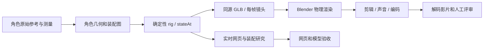

# 变形金刚复刻 · 可复用制作协议 v1

目标是持续产出可研究的双形态模型与有摄影意图的影片。沿用仓库的输入边界、案例索引、差异表和分阶段证据；新增角色契约、零件身份、双端约束与同源离线渲染。当前以[2007擎天柱](01-擎天柱-电影版/README.md)验证流程，仍需继续提高与原片的造型精度。

本文供成果维护和研究使用。独立任务的输入与要求以其冻结包为准。各执行者选择自己的技术和过程。

## 保留与重建

| 可沿用的流程/方法 | 每个角色必须重新建立 |
|---|---|
| 原始素材登记、哈希、权利与输入边界 | 具体电影版本、车辆型号与允许参考 |
| 稳定ID、装配图、确定性姿态/导出契约 | 头雕、曲面、零件归属、变形拓扑与避让路径 |
| 研究界面、灰模/分色/关节轴、同源GLB导出方法 | 能力系统、手足接触、武器或投影的实体属性 |
| 低机位/特写/跟随/拆解镜头配方 | 焦点与包围盒、相机路径、构图、速度和轴线 |
| PBR分区方法、HDRI许可登记、逐帧渲染门禁 | 角色车漆图案、UV、磨损与材质尺度 |
| 帧缓存指纹、实际视频解码检查、差异记录 | 每个镜头视觉评审和声音事件表 |

目前复用的是**数据契约与生产方法**；摄影棚、UI与导出代码保留在首个电影案例中作为可审查样本，没有声称所有角色已经能一键自动生成。第二个真实角色验证接口后，再抽公共运行库，避免把擎天柱坐标硬编码成全系列标准。



## 角色契约

案例根放 `production.json`，示例见[擎天柱契约](01-擎天柱-电影版/production.json)。`status=draft` 只是研究草稿，`study` 表示已有实现，仍不代表电影等同资产。

- `character` 固定角色和具体版本；`visualGoal` 与 `provenance` 分别声明目标和实现来源。
- `paths` 全部相对案例目录，禁止越界和符号链接逃逸。
- `rig.rootId` 是图外场景根；装配节点有稳定ID、父节点、系统、实体零件列表。零件只能有一个所有者；静态合批不会抹掉视觉分件清单。
- `requiredPorts / ports` 将头、躯干、左右手足等语义映射到真实装配ID；非人形角色自行声明所需接口，不能套用六轮规则。
- `timeline` 声明源动画、完整变形区间、帧率及成片到源时间的映射。至少一段连续镜头覆盖完整变形；高光剪辑不能替代中段机构证据。
- ID、语义端口和量纲属于契约；具体世界坐标属于角色。镜头配方先由端口/包围盒求取取景范围，再人工检查轮廓与遮挡，禁止直接照搬擎天柱相机坐标。

当前通用检查器验证原始媒体URL/文件哈希、路径、ID、归属、父子环、语义接口、剪辑连续性和完整变形覆盖；**不验证碰撞、拓扑真实性或视觉质量**。逐装配双端/中段追踪见[擎天柱去向证据](01-擎天柱-电影版/records/零件去向.md)，后续角色需重新生成，不能照抄矩阵。

```bash
python3 scripts/check_transformer_contract.py "series/变形金刚系列/01-擎天柱-电影版/production.json" --require-ready
```

## 制作关卡与证据

| 检查点 | 可用证据 | 如何排查 |
|---|---|---|
| 0 原始输入 | 来源URL/权利人/获取日期/哈希/版本、允许媒体与未知项 | 补缺失视图；混代素材退出主参考 |
| 1 测量与灰模 | 原帧地标、相机假设、车辆/人形/25/50/75%/侧背 | 先相机、姿态、轮廓；不先堆细节 |
| 2 装配与动作 | 车体→人形去向表、装配树、解锁/避让/展开/锁止、事件时间 | 身份/体积/接地/中段路径；不隐藏实体 |
| 3 精细与材质 | 外甲/骨架/连接、指节/活塞/铰链、UV与多种材料、无HUD近景 | 大曲面与层次，再磨损/微结构；避免皱箔与模板重复 |
| 4 摄影预演 | 镜头目的、焦点、轴线、速度、关键帧联系表 | 保主体、动作可读和合理轴线；删无目的晃动 |
| 5 双端输出 | 网页QA、同源GLB/镜头、样张、当前指纹 | 当前网页/导出/验收不一致时停止渲染 |
| 6 正式渲染 | 连续帧与配置指纹、剪辑/声音、实际MP4 | 坏帧/缓存不一致/缺帧禁止编码 |
| 7 交付审看 | 解码联系表、黑帧/冻结/电平、切点与试听记录、差异清单 | 将技术合格和艺术质量分开结论 |

公开记录实际模型、工具、人工介入与最终验收。详细轮次和诊断按需留本地。没有同机位匹配就不给“还原度百分比”；没有完整碰撞检测就不写“无穿模”。证据等级统一用 observed（原片可见）、inferred（机构/尺寸推断）、designed（展示设计）。

## 镜头配方

镜头变化来自叙事和机构事件，不靠随机绕圈、闪白或抖动制造复杂度。

| 配方 | 构图与运镜 | 接续依据 |
|---|---|---|
| 车辆建立 | 低机位¾，格栅/轮胎/漆面可读；缓慢推进 | 保持车辆行进方向；用引擎与气压衔接 |
| 连续变形 | 主体完整，随躯干起立后退/升高；中段不切 | 解锁→分离→抬升→展开→锁止；落位声作为转折 |
| 人形亮相 | 低机位¾，肩胸形成体量；小弧线而非急绕 | 接变形终点；短暂停顿让观众读剪影 |
| 头胸揭示 | 先头雕，再拉回/俯移到胸腔；焦点跟随 | 由装甲展开带出内构，景别改变有因果 |
| 前臂与手 | 甲片/轨道/刃边/指节在一镜可读 | 工具启动前留半拍，动作落位后切下一系统 |
| 下肢承重 | 低机位看髋膝踝与足部；避免无意义裁切 | 承重/锁止与低频声同步 |
| 分层拆解 | 固定可读中心，按系统错峰外移；微升高看层次 | 标为结构研究设计，不能冒充原片变形 |
| 重组与落幅 | 同方向收束，镜头缓收，头部轻转后停留 | 空间/速度匹配，留下完整英雄轮廓 |

曲线使用有界缓入缓出；切镜前后检查主体屏幕位置、运动方向、速度和光向。快速动作使用短快门运动模糊；切点关闭跨镜头快门。头部/手部细节不能靠景深完全糊掉。宽屏与竖屏需要不同机位和安全区，未重构机位不交付伪竖版。

## 开始下一个角色

以下只预览路径，不创建角色、不修改catalog：

```bash
python3 "series/变形金刚系列/tools/new_character.py" bumblebee-2007 --title "大黄蜂" --edition "Transformers (2007)" --dry-run
```

确认具体版本和原始参考后，去掉 `--dry-run` 创建研究草稿。脚手架只包含任务书、来源空表、契约、验收清单和显式报错的实现接口；不会复制擎天柱几何，也不会生成虚假成品或自动登记案例。[任务书模板](templates/character-brief.md) · [生产契约模板](templates/production.json) · [验收清单](templates/验收清单.md)。

阶段完成后再登记catalog/系列索引/NOTICE。原视频、依赖、便携工具和逐帧素材留在ignored的local/artifacts；未获得用户发布授权时不提交、不发布。


## 生产与呈现经验

资产锁、不可变输入、缓存摘要、构图预检和真实网页录制方法见[经验与实践](经验与实践.md)与[视频工作流](01-擎天柱-电影版/视频工作流.md)。

## 角色研究库与发布

[67个其他角色档案](characters/README.md)提供具体版本、图集/片段/图证入口与细粒度结构候选；不是成品列表。原始大图/影片留local，公开精选[研究板](references/README.md)与来源元数据；新复刻必须先取材，严格门禁使用`--require-local-media`。公开范围和版权边界见[发布说明](发布说明.md)。

默认角色初始化只带原始来源，语义端口与装配结构留给执行者建立。显式使用 --with-structure 时才携带 structure.json 的共享候选；它属于额外共同输入，必须在对照中一致声明，不能视为原片已经证明的机构。
