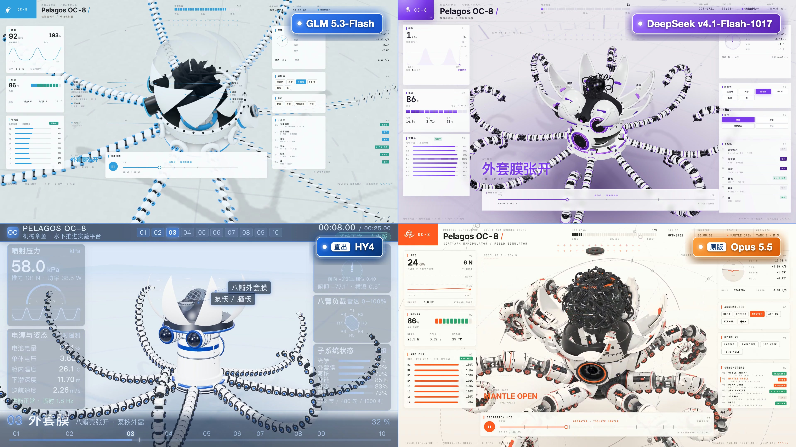

# 机械章鱼 OC-8 · 四宫格对照

[系列索引](../../README.md) · [快速开始](../../../../docs/快速开始.md)



3840×2160 / 30 fps / 25 秒；左上 GLM、右上 DeepSeek、左下 HY4 直出版、右下 @0x_fokki 原作。

[七帧接触表](验收-7帧接触表.jpg)

MP4 与原视频不随仓库分发。各版本输入和迭代不同，对照用于展示作品；历史铭牌与素材归属见 [NOTICE](../../../../NOTICE.md#对比展示与未分发内容)。

## 重新合成

先按[快速开始](../../../../docs/快速开始.md)安装共享依赖与 Chromium，另需 FFmpeg，并准备至少 25 秒、含音轨且有权使用的原视频。从**本目录**执行：

```bash
node tools/badges.mjs
node tools/render.mjs
ORIGINAL_VIDEO="/path/to/your/original.mp4" bash tools/compose.sh
```

将示例视频路径替换为实际路径。中间文件放系统临时目录的 `oc8-grid`，成片输出到本目录 `artifacts/`。

- `COMPARE_TMP`：覆盖中间文件目录，三步使用相同值。
- `COMPARE_DEST`：覆盖合成输出目录。
- `FRAMES=30 node tools/render.mjs`：生成一秒诊断片；正式合成前按默认 750 帧重新录制。
- `ONLY=hy`：只重录 HY 一路。

合成器检查输入时长、尺寸、帧率和原视频音轨，输出 ffprobe 规格。成片另需人工检查全部拍点、文字遮挡、黑帧、音画同步与首尾；现有封面及接触表为历史输出。
