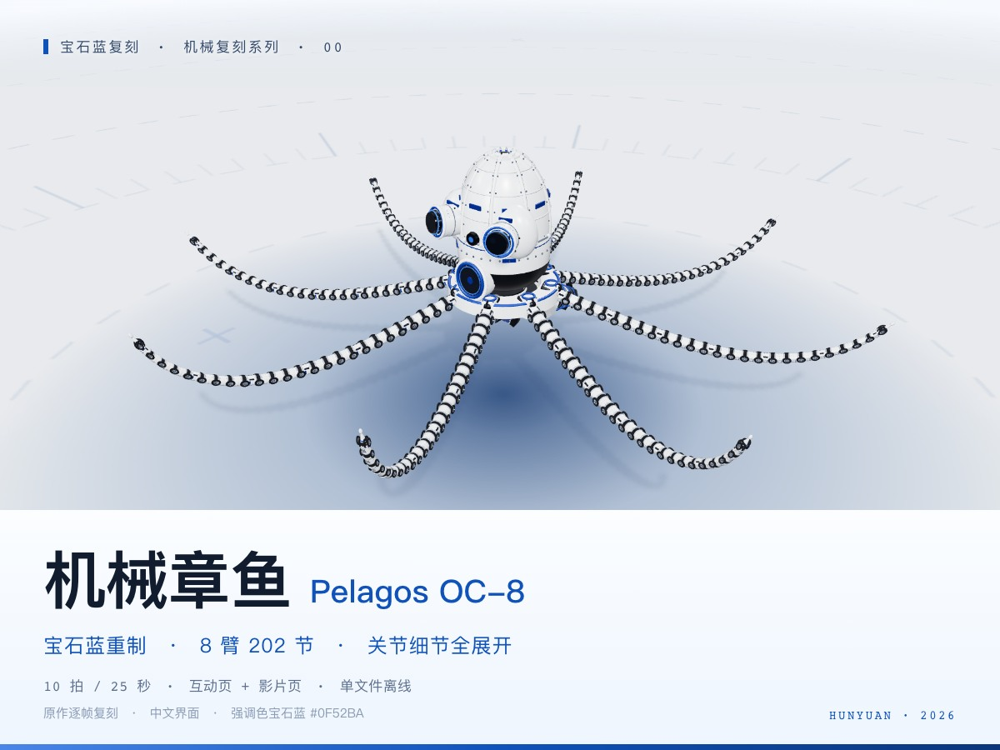

# HY 宝石蓝衍生版 · 机械章鱼 OC-8

基于 DeepSeek 实现改编，保留其 HUD、页面调度与构建链，重写腕足几何并调整配色、近景和拆解表现。独立重写版本见 [HY4 直出版](../hunyuan直出版/README.md)。

**仓库文档：** [系列索引](../README.md) · [快速开始](../../../docs/快速开始.md)

[](https://topmindspace.github.io/awesome-ai-recreations/series/机械复刻系列/hunyuan复刻/00-机械章鱼OC-8/机械章鱼OC-8-互动页.html)

## 在线演示与源码

| 案例 | 在线演示 ↗ | 仓库文件 |
|---|---|---|
| 机械章鱼OC-8 | [互动](https://topmindspace.github.io/awesome-ai-recreations/series/机械复刻系列/hunyuan复刻/00-机械章鱼OC-8/机械章鱼OC-8-互动页.html) · [自动巡览](https://topmindspace.github.io/awesome-ai-recreations/series/机械复刻系列/hunyuan复刻/00-机械章鱼OC-8/机械章鱼OC-8-影片页.html) | [源码](src) · [规格](src/00-机械章鱼OC-8/spec.md) |

25 秒自动巡览，下载后双击 HTML 可离线运行。[关节微距](00-机械章鱼OC-8/stills/光影-关节微距-无HUD.jpg) · [动作总览](00-机械章鱼OC-8/stills/总览-接触表.jpg)

## 重建与检查

需要 Node.js 20+，先按[快速开始](../../../docs/快速开始.md)安装共享依赖。从**本目录**执行：

```bash
cd src/kit
node build.mjs all
node ../00-机械章鱼OC-8/shared/check.mjs
node qa.mjs all
```

构建更新本目录两个 HTML。在 `src/kit/` 截取指定时刻：

```bash
node shot.mjs 00 ../../artifacts/stills --t=0,8,10,20 --mode=film
```

## 复刻资料

[机械章鱼任务书](../prompts/oc8.md) · [规格与改编项](src/00-机械章鱼OC-8/spec.md) · [实现与历史验证](records/实现与验证.md) · [参考来源](references/)

本版作为复用改编案例收录，模型沿用历史 Tencent Hunyuan Hy 署名。来源及许可见 [NOTICE](../../../NOTICE.md)。
