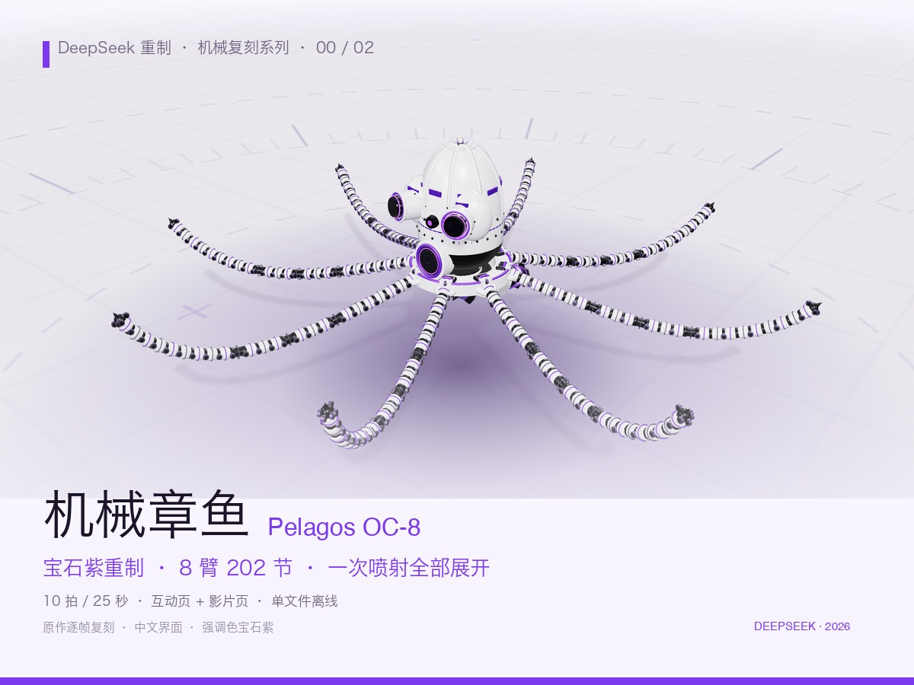

# DeepSeek · 机械章鱼与 V8

中文界面、宝石紫强调色，提供机械章鱼 OC-8 与 V8 发动机的互动演示和自动巡览。

**仓库文档：** [系列索引](../../README.md) · [快速开始](../../../../docs/快速开始.md)

[](https://topmindspace.github.io/awesome-ai-recreations/series/机械复刻系列/deepseek复刻/00-机械章鱼OC-8/机械章鱼OC-8-互动页.html)

## 在线演示与源码

| 案例 | 在线演示 ↗ | 仓库文件 |
|---|---|---|
| 机械章鱼OC-8 | [互动](https://topmindspace.github.io/awesome-ai-recreations/series/机械复刻系列/deepseek复刻/00-机械章鱼OC-8/机械章鱼OC-8-互动页.html) · [自动巡览](https://topmindspace.github.io/awesome-ai-recreations/series/机械复刻系列/deepseek复刻/00-机械章鱼OC-8/机械章鱼OC-8-影片页.html) | [源码](src/00-机械章鱼OC-8) · [规格](src/00-机械章鱼OC-8/spec.md) |
| V8发动机 | [互动](https://topmindspace.github.io/awesome-ai-recreations/series/机械复刻系列/deepseek复刻/01-V8发动机/V8发动机-互动页.html) · [自动巡览](https://topmindspace.github.io/awesome-ai-recreations/series/机械复刻系列/deepseek复刻/01-V8发动机/V8发动机-影片页.html) | [源码](src/01-V8发动机) · [规格](src/01-V8发动机/spec.md) |

下载后双击 HTML 可离线运行。互动页支持环绕、缩放、部件与视角切换；影片页按时间线自动巡览。

[章鱼动作总览](../../deepseek复刻/00-机械章鱼OC-8/stills/总览-接触表.jpg) · [V8 动作总览](../../deepseek复刻/01-V8发动机/stills/总览-接触表.jpg) · [原作参考](references/README.md)

## 重建与检查

需要 Node.js 20+，先按[快速开始](../../../../docs/快速开始.md)安装共享依赖。从**本目录**执行：

```bash
cd src/kit
node build.mjs all
node ../00-机械章鱼OC-8/shared/check.mjs
node ../01-V8发动机/shared/check.mjs
node qa.mjs all
```

构建更新本版本四个 HTML；`node build.mjs 00` 只构建章鱼。在 `src/kit/` 截取影片页指定时刻：

```bash
node shot.mjs 00 ../../artifacts/stills --t=0,8,16 --mode=film
```

## 复刻资料

[机械章鱼任务书](../../prompts/oc8.md) · [V8 任务入口](../../prompts/machines.md) · [实现与历史验证](records/实现与验证.md) · [公共库 API](src/kit/API.md)

历史实现为重新编写，V8 参考上游结构与参数；细节密度与部分机位有所简化。来源及许可见 [NOTICE](../../../../NOTICE.md)。
