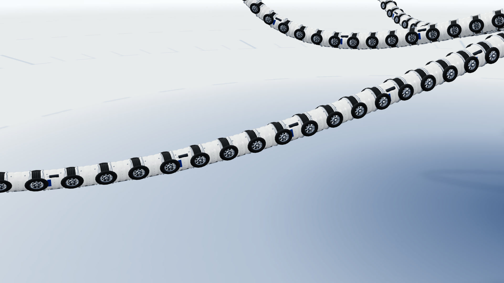

# HY 宝石蓝衍生版 · 实现与验证记录

[版本说明](../README.md) · [系列索引](../../../README.md)

以下保存已有实现的历史说明与验证结果，不代表新一次运行。当前使用命令见版本说明。

本版基于 DeepSeek 的 HUD、页面调度和 kit 改编。此前代码审计记录：`sim.js` 同源 99.8%，HUD 忽略配色后 100%，kit 多文件逐字节相同；这些统计用于说明复用关系，不作模型能力评分。

## 本版重点：关节细节

既有两版的腕足在整机镜头下偏「竹节 / 简化条纹」。本版在**不改 25 s 节拍、不改结构量**（8 腕 / 202 节 / 480 轮 / 1200 铆钉）、
**不改 `model.js` 数学契约**的前提下，重写 `shared/geometry-arm.js`，用约 26 个 `InstancedMesh` 把每一节叠成十层零件：

| 层 | 实现 | 材质 |
|---|---|---|
| 装甲筒 | 车削轮廓一次成型：两端法兰 + 退刀槽 + 两道分模环；筒长 32 mm，留 8 mm 给关节 | 白装甲 |
| 端法兰 | 两道银色法兰 + 中缝刻线 + 8 颗微型紧固螺钉 | 钢 |
| 检修板 | 深色密封框 + 银色圆角盖板，两层装配缝 | 钢 / 深灰 |
| 铆钉 | 每节 6 颗，两端各 3 颗绕筒分布，共 1200 颗 | 钢 |
| 丝印 | 4 套 Canvas 程序化贴花：编号 / 型号 / 条码 / 蓝白警示斜纹，按节号循环贴弧面 | 透明贴图 |
| 波纹关节 | 5 波黑色橡胶波纹管，波峰半径 18.4 mm 略大于筒身，节间明确露出 | 橡胶 |
| 万向节 | 球头 + 十字轴 + 两侧叉臂 | 深色金属 |
| 液压微缸 | 每节左右各一，活塞杆行程由 `model.hydraulicStroke(t, arm, j)` 驱动（**与 HUD 读数同源**） | 深灰 / 钢 |
| 线束 | 每节一段深色软管，串成沿腕走向的连续线缆 | 深灰 |
| 驱动滚轮 | 黑轮胎 + 钢轮辋 + 8 根辐条 + 轮毂 + 中轴 + 宝石蓝端盖，6 层叠绘；半径 24.8 mm | 橡胶 / 钢 / 宝石蓝 |

配套的画面改动：

- **10 s「R2 腕分离」推成中近景**，成片里直接看得清法兰、辐条与波纹关节；其余 9 拍机位与时间点照原作不变（`check.mjs` 有硬断言）。
- **20 s「整机拆解」位移量加倍**，外套膜 / 光学 / 虹吸 / 喙 / 臂毂 / 8 腕真正分离成爆炸图。
- 地面去掉满屏方格，只留同心刻度环 / 径向刻度 / 十字标记；地面压深到 `#DFEAF9`，与白装甲拉开明度。
- 所有紫色清除（含 Logo 渐变），强调色统一宝石蓝 `#0F52BA` / `#4A86E8` / `#0A357A` / `#BFD7FA`，与 GLM 版钴蓝 `#1E5FD6` 明确区分。
- `kit/shot.mjs` 增加 `--pose=px,py,pz,tx,ty,tz[,fov]`，可覆盖巡览机位输出关节微距静帧。

> 上图为 `--nohud --pose` 输出的腕足微距：可见独立白色装甲筒、银色端法兰与铆钉、黑色波纹万向节、
> 8 辐条滚轮（黑轮胎 / 钢轮辋 / 蓝端盖）、丝印编号与蓝白警示斜纹。

---

## 验证记录

| 检查 | 命令 | 结果 |
|---|---|---|
| 数学核心 60+ 条断言 | `node src/00-机械章鱼OC-8/shared/check.mjs` | 全部通过 ✓ |
| 单文件 / 零网络 / 零报错 / 交互冒烟 | `node src/kit/qa.mjs 00` | 两页全部通过 ✓ |
| 滚轮实例数守恒 | 每帧 `arms.pose()` 返回 480，与 `WHEELS_TOTAL` 断言 | 通过 ✓ |
| 逐帧渲染 | `shot.mjs` 10 拍 + 5 关键帧 + 微距 | 页面报错 0 ✓ |
| 旧配色残留 | 全目录扫描紫色色值 / 旧版本路径 | 仅剩「禁止使用宝石紫」等说明文字 ✓ |
