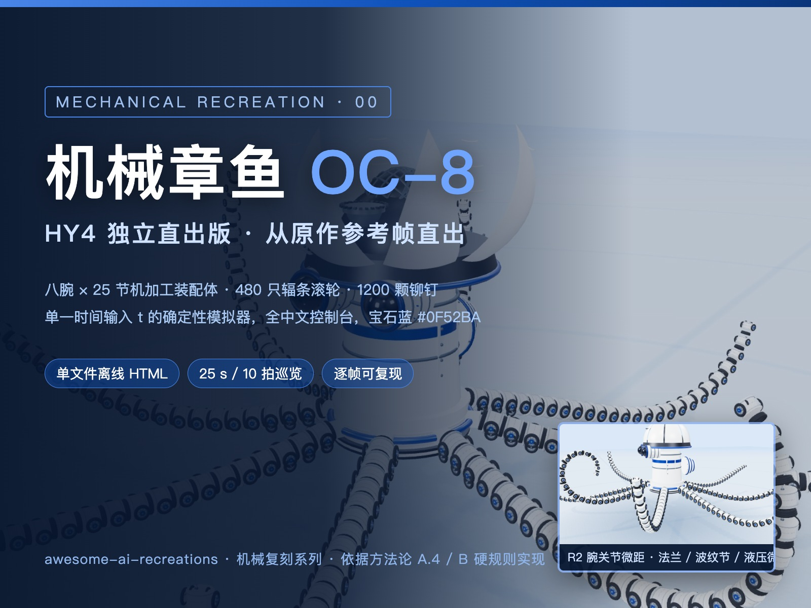

# HY4 直出版 · 机械章鱼 OC-8

中文界面、宝石蓝强调色，25 秒自动巡览。腕节包含法兰、紧固件、波纹关节、滚轮、液压杆与线束；HUD 与镜头为改编设计。

**仓库文档：** [系列索引](../../README.md) · [快速开始](../../../../docs/快速开始.md)

[](https://topmindspace.github.io/awesome-ai-recreations/series/机械复刻系列/hunyuan直出版/00-机械章鱼OC-8/机械章鱼OC-8-互动页.html)

## 在线演示与源码

| 案例 | 在线演示 ↗ | 仓库文件 |
|---|---|---|
| 机械章鱼OC-8 | [互动](https://topmindspace.github.io/awesome-ai-recreations/series/机械复刻系列/hunyuan直出版/00-机械章鱼OC-8/机械章鱼OC-8-互动页.html) · [自动巡览](https://topmindspace.github.io/awesome-ai-recreations/series/机械复刻系列/hunyuan直出版/00-机械章鱼OC-8/机械章鱼OC-8-影片页.html) | [源码](src) · [规格](spec.md) |

下载后双击 HTML 可离线运行。[动作总览](../../hunyuan直出版/00-机械章鱼OC-8/stills/总览-十拍接触表.jpg) · [关键静帧](../../hunyuan直出版/00-机械章鱼OC-8/stills/)

## 重建与检查

Node.js 20+。从**本目录**执行：

```bash
npm ci
npx playwright install chromium
npm run build
npm run check
npm run qa
```

构建更新本目录两个 HTML。截图与资源生成也从本目录执行：

```bash
node tools/capture.mjs --t=0,7.8,10.4,21.5 --out=artifacts/stills
node tools/assets.mjs  # 更新正式静帧、接触表与封面
```

## 复刻资料

[机械章鱼任务书](../../prompts/oc8.md) · [规格](spec.md) · [输入、偏差与历史验证](records/实现与验证.md) · [参考来源](../deepseek/references/README.md)

本版按历史记录为独立重写，与[基于 DeepSeek 的宝石蓝衍生版](../hy-derived/README.md)分开收录。模型沿用 HY4 / Tencent Hunyuan Hy 署名，精确 API ID 与完整历史提示词未归档。来源及许可见 [NOTICE](../../../../NOTICE.md)。
